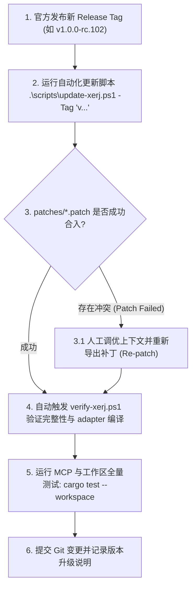

# XERJ 官方源码升级与目录治理整体方案

> **文档路径**：`docs/xerj-upgrade-guide.md`  
> **上游仓库**：[https://github.com/xerj-org/xerj](https://github.com/xerj-org/xerj)  
> **核心定位**：提供底层搜索、倒排索引、向量检索和 Memory Chunk 存储引擎。  
> **当前版本**：`v1.0.0-rc.101` (`commit: 83c9f0d123bac010a25ca2cf02ff093b08ee68ce`)

---

## 一、当前 `crates/xerj` 架构现状与合理性评估

### 1.1 核心机制还原
经对工程代码与补丁体系的深度审查，当前项目采用的是**“Vendor 源码胶囊 + 自动化 Patch 补丁注入”**体系：
1. **源码胶囊构成**：
   - `crates/xerj/engine/`：包含 XERJ 官方的 18+ 个底层 Rust crate（如 `xerj-engine`, `xerj-server`, `xerj-mcp`, `xerj-query` 等）。
   - `crates/xerj/xerj-ux/`：仅约 1.2MB 的纯原生无编译 (buildless) SPA 静态文件，专用于在 `server` 模式下为 `8080` 端口的 `/_xerj-console/` 运维管理控制台提供界面资产支持。
   - `crates/xerj/UPSTREAM_VERSION`：显式记录当前内嵌 XERJ 的上游仓库地址、Release Tag、Git Commit SHA、抓取时间与 Patch 清单。
2. **根工作区隔离**：根目录 `Cargo.toml` 中配置了 `exclude = ["crates/xerj", "crates/xerj/engine"]`，完全隔离了 `amemory` (Rust 2024 edition) 与 XERJ (Rust 2021 edition) 的 Workspace 规则与构建体系。
3. **关键扩展补丁 (`patches/`)**：由于官方原版 XERJ 主要是独立可执行二进制或 CLI 运行，为了在 `amemory` 中作为进程内库嵌入，本项目定制了两个关键补丁：
   - `patches/0001-expose-mcp-provider.patch`：为 `xerj-mcp` 增加了 `McpProvider` 接口，以便统一注入 MCP 工具。
   - `patches/0002-expose-server-bootstrap.patch`：为 `xerj-server` 导出了 `[lib]` 库模式和进程内服务启动引导句柄。
4. **适配隔离层 (`crates/adapter`)**：上层业务代码（如 `amemory_runtime.rs`、桌面 GUI 界面）只与 `adapter` 和 `domain` 交互，绝不直接越级调用底层 XERJ 内部未经抽象的私有 API。

### 1.2 架构合理性评估

#### 合理与优秀之处：
- **极佳的解耦性**：通过 `crates/adapter` 作为防腐层（Anti-Corruption Layer），任何底层引擎升级只要维持 `adapter` 暴露的接口契约，上层整个桌面 GUI 与服务完全无感。
- **构建独立性**：内嵌模式无需依赖外部不可控的 Git 凭据或网络波动，离线和纯内网依然可以稳定编译。
- **双重版本锁定**：`patches/upstream.toml` 与 `crates/xerj/UPSTREAM_VERSION` 确保任何团队成员清晰知晓当前源码的上游版本。

#### 升级时必须注意的红线：
- **切勿直接手工覆盖源码**：**这是升级中最容易踩坑的地方！** 如果直接将官方新 Release 解压覆盖到 `crates/xerj`，本地针对 XERJ 的定制补丁会被瞬间抹除，导致 `crates/mcp` 与 `crates/adapter` 编译崩溃。必须统一使用 `scripts/update-xerj.ps1` 进行自动化升级。

---

## 二、官方升级时的整体替换方案

我们制定**“自动化抓取 -> 源码替换 -> 补丁重放 (Re-patch) -> 元数据同步 -> 多层防腐验证”**的闭环升级方案：



---

## 三、标准化升级实操指引

### 步骤 1：创建升级隔离分支
在准备升级官方源码前，务必创建独立升级分支，确保主分支安全：
```bash
git checkout -b chore/upgrade-xerj-<new-version>
```

### 步骤 2：执行自动化升级流水线
在项目根目录下通过 PowerShell 执行：
```powershell
# 升级到指定的 Release Tag（例如 v1.0.0-rc.102）
.\scripts\update-xerj.ps1 -Tag "v1.0.0-rc.102"
```

该脚本已完全自动化：
1. 从 `https://github.com/xerj-org/xerj.git` 浅克隆指定分支/Tag。
2. 提取最新源码并更新 `crates/xerj/`。
3. 自动按顺序执行 `git apply` 打入 `patches/` 下的定制补丁。
4. 更新 `patches/upstream.toml` 与 `crates/xerj/UPSTREAM_VERSION` 中的 Commit SHA、Tag 与抓取时间戳。
5. 自动调用 `scripts/verify-xerj.ps1` 执行文件完整性、补丁注入状态与 `adapter` 快速编译自检。

### 步骤 3：补丁冲突处理机制（如遇 Patch 失败）
如果官方重构了对应文件，`update-xerj.ps1` 会捕获异常并给出清晰排查步骤：
1. **查看冲突位置**：
   ```powershell
   git apply --directory="crates/xerj" --reject "patches/0001-expose-mcp-provider.patch"
   ```
2. **人工合并适配**：打开生成的 `.rej` 文件查看冲突差异，在对应文件中恢复 `McpProvider` 或导出结构。
3. **重新生成补丁并覆盖**：
   ```powershell
   git diff crates/xerj/engine/crates/xerj-mcp > patches/0001-expose-mcp-provider.patch
   git diff crates/xerj/engine/crates/xerj-server > patches/0002-expose-server-bootstrap.patch
   ```

### 步骤 4：分级回归测试流水线
升级脚本顺利执行后，运行以下三项测试完成最终验收：
```powershell
# 1. 验证 Adapter 适配防腐层
cargo test -p adapter

# 2. 验证 MCP 聚合工具层
cargo test -p xcat-mcp

# 3. 验证主工程与全工作区集成
cargo clippy --all-targets --all-features -- -D warnings
cargo test --workspace
```

### 步骤 5：启动 GUI 验证索引重建能力
启动桌面应用，打开 **设置 -> XERJ 搜索引擎**，点击 **【立即重构】**：
- 观察控制台日志是否有段合并异常。
- 检查右侧状态面板显示的“文档总数”、“段数量 (Segments)”与 P95 检索延迟。

---

## 四、长效治理建议

1. **补丁自动化守护**：每次代码提交或 CI 构建中运行 `.\scripts\verify-xerj.ps1`，确保定制的 `McpProvider` 与 `RunningServer` 未被误删。
2. **上游回馈 (Upstream PR)**：将 `McpProvider` 等进程内接入接口提交给 [xerj-org/xerj](https://github.com/xerj-org/xerj) 官方。一旦官方合入主干，后续项目便可清空 `patches/` 目录，实现零摩擦平滑升级。
