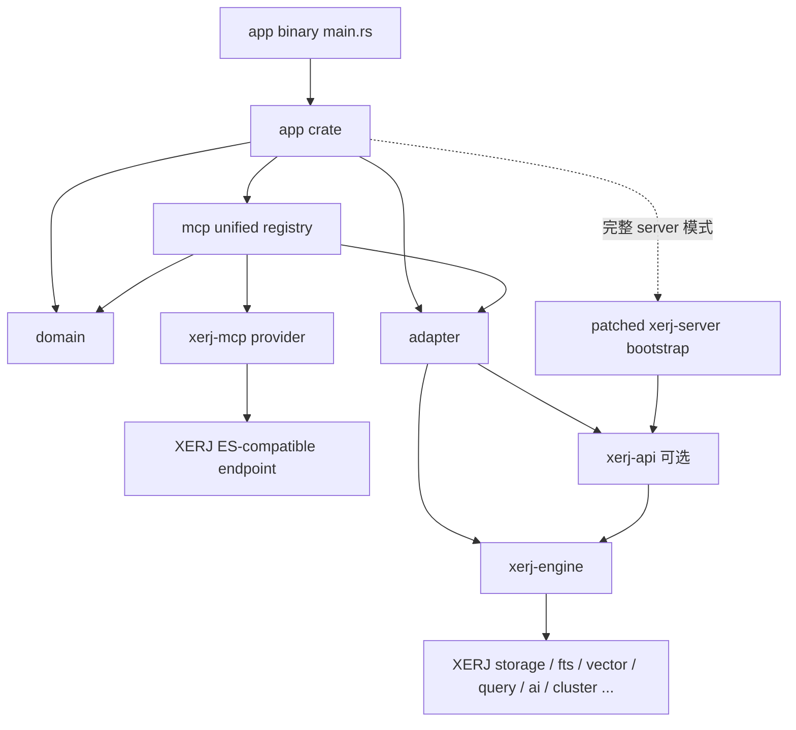

# Amemory 以 XERJ 为核心的架构改造方案

> 状态：规划稿，不包含代码改造
>
> 核对基线：XERJ `1.0.0-rc.101`，2026-11-06 读取上游 `main` 分支
>
> 上游仓库：<https://github.com/xerj-org/xerj>

## 1. 结论摘要

本次改造建议采用以下总体方案：

1. **XERJ 是唯一的搜索、索引和 Memory 核心**，新架构不保留第二套存储引擎。
2. **不要重新拆分、合并或改名 XERJ 的 crate**。保留上游现有 18 个 crate 及其独立 workspace。
3. **不能只复制 `engine/crates/`**。应保存一份可整体替换的“XERJ 上游源码胶囊”，至少包含 `engine/Cargo.toml`、`engine/crates/`、`engine/proto/`、许可证，以及需要 Console 时的 `xerj-ux/`。
4. Amemory 自有代码建议拆成 **5 个 crate**：1 个二进制入口和 4 个库 crate。
5. XERJ Engine/API 调用集中在 `adapter`；`mcp` 只额外依赖上游 `xerj-mcp` 的可组合接口，不直接依赖 XERJ 叶子 crate。
6. `app/src/main.rs` 只作为 composition root：加载配置、初始化日志、组装依赖、启动任务、处理退出，不承载索引和业务规则。
7. `mcp` 必须统一提供当前项目 tools 和 XERJ 全部原生 tools；通过 `xerj-mcp` provider 补丁组合实现，不能复制 23 个工具形成分叉。
8. 若最终需要 XERJ 完整生产能力，应对 `xerj-server` 维护一个**行为改动极小的 bootstrap 补丁**，将其 binary-only 启动逻辑暴露为 library API；不能把上游庞大的 `main.rs` 复制到 Amemory 后长期魔改。
9. 第一期先让 Amemory MCP HTTP 与 XERJ HTTP **使用不同监听端口**。当前项目使用 Axum 0.8，XERJ 使用 Axum 0.7，两者的 `Router` 类型不兼容，不能直接 `merge`。
10. Skill 和 Book 文件系统继续作为事实来源；XERJ 中的数据是可重建的派生索引。
11. XERJ 升级时，应替换完整源码胶囊、自动重放小型补丁、执行双 workspace 验证，而不是手工覆盖某几个 crate。

推荐数量如下：

| 范围                | 数量 | 处理方式                     |
| ------------------- | ---: | ---------------------------- |
| XERJ 上游生产 crate |   18 | 原样保留，不重新拆分         |
| XERJ ES 兼容测试包  |    1 | 随上游保存，不计入生产 crate |
| Amemory 自有 crate  |    5 | 1 个入口 + 4 个库            |
| 合计生产 crate      |   23 | 两个 workspace 管理          |

如果希望第一阶段更轻，可暂时把 `crates/app` 合并进顶层 `app` 二进制入口，形成 4 个自有 crate；长期仍推荐 5 个，以便单独测试启动编排。

---

## 2. 改造目标与非目标

### 2.1 目标

- 使用 XERJ 提供全文、向量、混合检索和 Memory 能力。
- 保留当前 Skill、Book、通用 Memory 的 MCP 能力和 stdio/HTTP 入口。
- Skill/Book 目录仍然是事实来源，索引损坏后可全量重建。
- Amemory 业务代码与 XERJ 上游源码隔离。
- 升级 XERJ 时尽量做到：整体替换、自动应用补丁、编译和测试，而不是人工逐文件合并。
- 能分别验证“未修改的 XERJ 上游基线”和“Amemory 最终产品”。
- 新 workspace 从建立起只依赖 XERJ，彻底删除旧存储依赖、代码、配置和数据格式兼容层。

### 2.2 非目标

- 不重新设计 XERJ 内部的存储、查询、集群或 AI crate。
- 不把 Amemory 的 Skill/Book 逻辑提交进 XERJ 叶子 crate。
- 不假设 XERJ 已提供稳定的动态插件系统；当前方案依靠 adapter 和极小 bootstrap patch，不依赖不存在的插件机制。
- 不为旧存储格式提供读取、转换、并行写入或故障转用兼容层。
- 不在第一阶段追求 Amemory MCP Router 与 XERJ Router 共用同一端口。

---

## 3. 当前项目边界

当前项目是单 package：`xflash-mcp`。主要职责混合在同一 crate 中：

| 当前文件           | 当前职责                              | 改造要求                         |
| ------------------ | ------------------------------------- | -------------------------------- |
| `src/main.rs`      | 配置、panic、日志、启动               | 移到顶层 `app`                   |
| `src/app.rs`       | 旧存储同步、MCP stdio/HTTP 生命周期   | 删除旧存储流程，保留生命周期编排 |
| `src/service.rs`   | MCP tools、输入校验、目录变更、搜索   | 改为统一 MCP registry            |
| `src/skills.rs`    | Skill 扫描、变更、分段、旧存储同步    | 仅保留领域规则，索引交给 adapter |
| `src/books.rs`     | Book 扫描、文档导入、分段、旧存储同步 | 仅保留领域规则，索引交给 adapter |
| `src/embedding.rs` | 旧引擎的 embedding 构造               | 删除，统一使用 XERJ 能力         |
| `src/config.rs`    | 配置读取与验证                        | 只保留 XERJ 和应用配置           |

当前最大的改造风险不是 MCP transport，而是领域规则与旧存储写入代码交织。例如 `skills.rs`、`books.rs` 同时负责：

- 文件系统扫描和安全校验；
- 领域模型构造；
- 文本切分；
- 稳定 URI/标识生成；
- 存储差量判断；
- 旧存储写入和删除。

应先拆出存储无关的领域结果，再由 `adapter` 完成 XERJ 写入。旧存储代码不迁入任何新 crate。

---

## 4. XERJ 源码分析

### 4.1 上游现有 18 个 crate

XERJ `engine/Cargo.toml` 当前包含以下 18 个生产 crate：

| 分层       | crate              | 职责定位                                             | 本方案处理               |
| ---------- | ------------------ | ---------------------------------------------------- | ------------------------ |
| 基础       | `xerj-common`      | 公共配置、指标和共享类型                             | 原样保留                 |
| 基础       | `xerj-compress`    | 压缩能力                                             | 原样保留                 |
| 数据与索引 | `xerj-storage`     | 底层存储                                             | 原样保留                 |
| 数据与索引 | `xerj-fts`         | 全文索引                                             | 原样保留                 |
| 数据与索引 | `xerj-vector`      | 向量索引                                             | 原样保留                 |
| 数据与索引 | `xerj-logs`        | 日志分析相关能力                                     | 原样保留                 |
| 查询与智能 | `xerj-query`       | 查询模型和执行相关能力                               | 原样保留                 |
| 查询与智能 | `xerj-rerank`      | 重排和 judge 能力                                    | 原样保留                 |
| 查询与智能 | `xerj-ai`          | embedding/AI 能力                                    | 原样保留                 |
| 查询与智能 | `xerj-wasm`        | WASM 扩展执行能力                                    | 原样保留                 |
| 分布式     | `xerj-cluster`     | 集群和 shard 协作                                    | 原样保留                 |
| 核心组装   | `xerj-engine`      | 组装 storage/fts/vector/query 等子系统               | Amemory 核心适配入口之一 |
| 接口       | `xerj-api`         | Native/ES-compatible Axum Router、`AppState`         | HTTP 集成入口之一        |
| 接口       | `xerj-mcp`         | 代理 XERJ HTTP 端点的标准 MCP 工具                   | 全部接入本项目 `mcp` 层  |
| 接口       | `xerj-autoindex`   | 文件夹预算、自动索引、CLI library API                | 可选复用                 |
| 接口       | `xerj-hub`         | Corpus Hub 相关流程                                  | 随上游保留               |
| 接口       | `xerj-console-api` | Console API 和静态资源挂载                           | 完整 server 模式使用     |
| 二进制     | `xerj-server`      | TLS、REST、ES、gRPC、Console、cluster、CLI、生命周期 | 需要 bootstrap 补丁      |

另有 `engine/tests/es-compat-yaml` 测试 package。它应随上游源码保存，但不计入 18 个生产 crate。

### 4.2 不建议再拆分 XERJ

“把 XERJ 源码放进项目”不等于“重新拆 XERJ”。上游已经把能力分成 18 个 crate，Amemory 再拆一次会产生以下问题：

- 改写所有 `path` 依赖和 `workspace = true` 继承关系；
- XERJ 新版本无法通过整体目录替换升级；
- 每次上游移动模块都会变成大面积冲突；
- 无法直接执行上游按 package 划分的 build/test；
- 容易形成 Amemory 对 `xerj-storage`、`xerj-fts` 等内部实现的横向依赖；
- 上游 bug 修复很难判断应移植到哪个本地派生 crate；
- 许可证、构建脚本、feature 和发布配置容易遗漏。

因此，本方案中的“拆分”只针对 Amemory 自有代码，XERJ 的 18 个 crate 不动。

### 4.3 三种引入层级的实际构建闭包

| 引入方式             | 约涉及的 XERJ 生产 crate | 能力                                                 | 评价                               |
| -------------------- | -----------------------: | ---------------------------------------------------- | ---------------------------------- |
| 只依赖 `xerj-engine` |                       11 | 内嵌索引和搜索核心                                   | 最轻，但需自行处理接口和生命周期   |
| 依赖 `xerj-api`      |                       15 | Engine + Native/ES Router                            | 可嵌入，但缺少完整生产 server 编排 |
| 使用 `xerj-server`   |                       18 | TLS、REST、ES、gRPC、Console、cluster、CLI、生命周期 | 最完整，但当前是 binary-only       |

数量按 `1.0.0-rc.101` 当前依赖图估算；上游升级后必须通过 `cargo metadata` 重新确认，不能把数量写死进脚本。

### 4.4 `xerj-api` 可以嵌入，但不等于完整 XERJ Server

`xerj-api` 已公开：

- `AppState`；
- `build_native_router`；
- `build_es_compat_router`；
- `build_es_compat_router_with_hub`。

它的文档明确展示了自行创建 `Config`、`Engine`、`AppState` 和两套 Axum Router 的方式。因此，第一阶段可以直接在 Amemory 进程内嵌 Engine/API。

但 `xerj-api` 不包含 `xerj-server` 的全部生产编排。当前 `xerj-server/src/main.rs` 还承担：

- TLS 初始化和监听；
- gRPC 服务；
- Native API 与 ES-compatible API；
- Console API 和 UI 合并；
- cluster transport；
- allocator 配置；
- CLI 和 subcommands；
- server lifecycle 和退出协调；
- share、brain 等生产编排。

如果 Amemory 自己依据 `xerj-api` 重写这些能力，将长期复制上游 server 行为，升级成本会远高于维护一个边界清晰的 bootstrap patch。

### 4.5 `xerj-server` 的关键阻塞

`xerj-server` 当前只有：

```toml
[[bin]]
name = "xerj"
path = "src/main.rs"
```

它没有可供 Amemory 调用的 `lib.rs`。因此不能直接在 `app/src/main.rs` 中调用“完整 XERJ server”。

长期推荐给 vendored XERJ 应用一个补丁：

1. 将生产启动编排提取到 `xerj-server/src/lib.rs` 或独立 `bootstrap` 模块；
2. 暴露稳定且尽量小的 `run(...)` / `run_with_extensions(...)` 接口；
3. 上游 `xerj-server/src/main.rs` 退化为参数解析后调用 library 的薄 wrapper；
4. 允许 Amemory 注入生命周期 hook，必要时注入额外 HTTP service；
5. 保持 TLS、gRPC、Console、cluster 和 allocator 行为与上游二进制一致。

该补丁可能包含较多机械移动，但**语义改动必须很小**，并且不得修改 storage、fts、vector、query 等核心 crate。

### 4.6 不能只复制 `engine/crates/`

XERJ crate 大量使用：

```toml
version.workspace = true
edition.workspace = true
some_dependency.workspace = true
```

所以 `engine/Cargo.toml` 是必需的。除此之外，构建脚本还依赖 workspace 外资源：

- `xerj-server/build.rs` 从 `engine/proto/xerj.proto` 生成 gRPC stub；
- `xerj-console-api/build.rs` 会尝试寻找仓库根部的 `xerj-ux/` 并将资源编进二进制；
- 缺少 `xerj-ux/` 时 Console crate 仍可能编译，但生成的是空资源表，最终 UI 不完整；
- 上游测试还依赖 `engine/tests/es-compat-yaml/`；
- 发布和审计需要保留 `LICENSE`、`NOTICE` 等文件。

最低建议保存：

```text
crates/xerj/
├── LICENSE
├── NOTICE                         # 上游存在时保留
├── README.md
├── engine/
│   ├── Cargo.toml
│   ├── Cargo.lock
│   ├── .cargo/
│   │   └── config.toml            # 上游存在时保留
│   ├── crates/                    # 18 个 crate
│   ├── proto/
│   │   └── xerj.proto
│   └── tests/
│       └── es-compat-yaml/
└── xerj-ux/                       # 需要完整 Console 时必须保存
```

原则是保存“构建和验证所需的完整上游快照”，而不是手工挑选看起来有用的 Rust 文件。

---

## 5. 推荐仓库结构

```text
amemory/
├── Cargo.toml                     # Amemory workspace，显式列出 members
├── Cargo.lock                     # Amemory 最终产品构建锁
├── app/
│   ├── Cargo.toml                 # binary package: amemory
│   └── src/
│       └── main.rs                # 唯一产品入口，composition root
├── crates/
│   ├── app/
│   │   ├── Cargo.toml
│   │   └── src/lib.rs             # 配置、启动编排、任务生命周期
│   ├── domain/
│   │   ├── Cargo.toml
│   │   └── src/
│   │       ├── lib.rs
│   │       ├── skill.rs
│   │       ├── book.rs
│   │       ├── document.rs
│   │       └── memory.rs
│   ├── mcp/
│   │   ├── Cargo.toml
│   │   └── src/
│   │       ├── lib.rs
│   │       ├── registry.rs         # 合并本项目与 XERJ tools
│   │       ├── amemory.rs          # Skill/Book 定制 tools
│   │       ├── xerj.rs             # xerj-mcp provider 适配
│   │       ├── stdio.rs
│   │       └── http.rs
│   ├── adapter/
│   │   ├── Cargo.toml
│   │   └── src/
│   │       ├── lib.rs
│   │       ├── engine.rs
│   │       ├── index.rs
│   │       ├── search.rs
│   │       └── mapping.rs
│   └── xerj/                      # 可整体替换的上游源码胶囊
│       ├── LICENSE
│       ├── engine/
│       │   ├── Cargo.toml         # XERJ 独立 workspace
│       │   ├── Cargo.lock
│       │   ├── crates/            # XERJ 上游 18 个 crate
│       │   ├── proto/
│       │   └── tests/
│       └── xerj-ux/
├── patches/
│   └── xerj/
│       ├── upstream.toml          # tag、commit、获取时间、校验信息
│       ├── 0001-expose-mcp-provider.patch
│       ├── 0002-expose-server-bootstrap.patch
│       └── 0003-add-server-extension-hook.patch  # 确有需要时再增加
├── scripts/
│   ├── update-xerj.ps1
│   └── verify-xerj.ps1
├── docs/
│   └── 架构改造.md
├── etc/
├── skills/
└── books/
```

### 5.1 为什么采用两个 workspace

推荐保留两个独立 workspace：

1. 根目录 Amemory workspace：顶层 `app` 和 `crates/app`、`crates/domain`、`crates/mcp`、`crates/adapter`；
2. `crates/xerj/engine`：上游原生 workspace。

Amemory 通过 `path` dependency 使用 XERJ library crate，但不把 18 个 XERJ crate 重新声明成根 workspace member。

这样做的价值：

- XERJ 的 `workspace.package`、`workspace.dependencies` 和 profile 原样有效；
- 可以在 `crates/xerj/engine` 单独运行上游命令；
- 上游升级时可以替换整个 `crates/xerj`；
- Amemory workspace 不需要复制 XERJ 的 workspace 依赖表；
- 根 `Cargo.lock` 锁定产品实际解析结果；XERJ 自带 `Cargo.lock` 用于验证纯上游快照。

根 workspace 必须显式列出自有 members，不使用 `crates/*` 通配符，并排除 XERJ 的嵌套 workspace：

```toml
[workspace]
resolver = "2"
members = [
    "app",
    "crates/app",
    "crates/domain",
    "crates/mcp",
    "crates/adapter",
]
exclude = ["crates/xerj/engine"]
```

这样可以避免把 `crates/xerj/engine/crates/*` 误收进根 workspace，同时保持 XERJ 原生 workspace 独立。

---

## 6. Amemory 自有 5 个 crate 的职责

### 6.1 顶层 `app/`：二进制入口

路径：`app/src/main.rs`

只负责：

- 调用配置加载；
- 初始化唯一的日志/tracing subscriber；
- 初始化 panic hook；
- 调用 `app::run`；
- 将顶层错误映射为退出码。

禁止：

- 直接调用 `xerj-storage`、`xerj-engine`；
- 编写 Skill/Book 同步规则；
- 定义 MCP tools；
- 直接操作索引文档；
- 复制 XERJ server 启动代码。

用户所说的 `main.c` 在本项目中应为 Rust 的 `main.rs`。

### 6.2 `crates/app`：产品启动与生命周期

负责：

- Amemory 配置模型和校验；
- 创建 `adapter`；
- 首次全量同步和后续增量同步；
- 启动 MCP HTTP/stdio；
- 选择“仅同步、MCP stdio、MCP HTTP、完整 server”等运行模式；
- cancellation token、Ctrl+C、任务退出和错误传播；
- 在长期方案中调用 patched `xerj-server` bootstrap。

它可以依赖 `domain`、`adapter`、`mcp`，但不直接依赖 XERJ 叶子 crate。

### 6.3 `domain`：Skill/Book/Memory 领域层

负责：

- Skill 和 Book 的领域模型；
- 文件名、路径和 frontmatter 校验；
- 目录扫描；
- 文档大小与允许根目录限制；
- 文本分段；
- 稳定文档 ID 和 content hash；
- 创建、更新、删除文件的领域规则；
- 生成与存储无关的 `IndexDocument` / `IndexMutation`。

必须满足：

- 不依赖任何 `xerj-*` crate；
- 不依赖任何具体存储实现；
- 不依赖 RMCP 或 Axum；
- 单元测试可以不启动数据库或网络。

### 6.4 `adapter`：XERJ Engine/API 隔离层

负责：

- 创建/打开 XERJ Engine；
- 创建 index 和 mapping；
- bulk upsert/delete；
- refresh/flush；
- 全文、向量、混合查询；
- 将 XERJ error 映射为 Amemory error；
- 将 XERJ hit 映射为领域搜索结果；
- 提供临时目录集成测试；
- 隔离上游版本变化。

建议对上层暴露 Amemory 自己的窄接口，例如：

```rust
pub trait SearchStore {
    async fn apply(&self, mutations: &[IndexMutation]) -> Result<SyncReport>;
    async fn search(&self, request: SearchRequest) -> Result<Vec<SearchHit>>;
    async fn stats(&self) -> Result<StoreStats>;
}
```

具体接口在实施阶段根据同步/异步需要确定；关键是 trait 和 DTO 归 Amemory 所有，不能把 `xerj_engine::*` 类型泄漏到 `domain` 或 `mcp`。

### 6.5 `mcp`：统一 MCP 接口层

`mcp` 是产品唯一的 MCP 门面，必须同时提供两组能力：

1. 当前项目的 Skill、Book 和定制 Memory tools；
2. XERJ `xerj-mcp` 的全部原生 tools。

它负责：

- 保留当前 Skill/Book/Memory MCP tools；
- 完整注册 XERJ 原生 MCP tools；
- 合并两组 tool schema，并在名称冲突时拒绝启动；
- MCP 参数、响应和错误映射；
- 唯一的 stdio JSON-RPC 生命周期；
- Streamable HTTP transport；
- 请求大小、取消、并发调用和输出预算约束；
- 保证 stdio stdout 只承载 MCP 协议。

按当前 XERJ 基线，`xerj-mcp` 在配置 Hub key 时公开 23 个 tools，无 Hub key 时公开其中 20 个。需要保留的原生 tool 包括：

- 检索：`xerj_def`、`xerj_batch_search`、`xerj_search`、`xerj_semantic_search`、`xerj_vector_search`、`xerj_hybrid_search`、`xerj_code_search`；
- Memory：`xerj_memory_store`、`xerj_memory_recall`；
- Second Brain：`xerj_brain_ego`、`xerj_brain_link`、`xerj_brain_unlink`、`xerj_brain_overview`；
- 索引与状态：`xerj_map`、`xerj_index_budget`、`xerj_autoindex_remove`、`xerj_status`；
- 规划与反馈：`xerj_plan`、`xerj_field_report`、`xerj_corpus_feedback`；
- Corpus Hub：`xerj_hub_find`、`xerj_hub_def`、`xerj_hub_ask`。

工具数量和名称是版本基线，不应在业务代码中写死；升级时应与上游 `xerj_mcp::tool_specs_with(...)` 做集合和 schema 差异检查。

#### XERJ MCP 的组合方式

当前 `xerj-mcp` 虽然是 library-first，但主要入口 `xerj_mcp::run` 会直接占用 stdin/stdout；它不能和 Amemory 现有 MCP 服务同时启动，否则两个 JSON-RPC 循环会争用同一 stdio。上游当前公开 tool schema，但实际 tool dispatcher 仍是私有实现。

因此应给 vendored `xerj-mcp` 应用一个小型 `0001-expose-mcp-provider.patch`，只增加协议无关的可组合边界，例如：

- 根据 URL、认证和超时创建 provider；
- 获取上游原始 tool specs；
- 按 tool name 和 arguments 调用上游 dispatcher；
- 保留上游取消、token budget、Hub key 条件和错误语义；
- 原有 `xerj_mcp::run` 继续通过同一个 provider 工作，避免形成两套实现。

本项目 `crates/mcp` 负责唯一 transport 和统一 registry；它调用 `xerj-mcp` provider 执行所有 `xerj_*` tools，同时调用 `domain` 与 `adapter` 执行 Skill/Book 定制 tools。

由于上游原生 tools 通过 HTTP 代理到 XERJ ES-compatible endpoint，统一 MCP 启动前必须满足以下之一：启动同进程的 loopback ES-compatible listener，或配置一个已经运行的 XERJ 节点。仅创建内嵌 Engine 而不启动 API listener，无法完整支持这些原生 tools。

禁止把 XERJ 的 23 个 tool 实现复制到 `crates/mcp` 后独立维护。源码仍保留在上游 `crates/xerj/engine/crates/xerj-mcp`，`mcp` 层只负责组合和暴露，这样升级 XERJ 时能自动获得新增工具和修复。

---

## 7. 依赖方向



强制依赖规则：

1. `domain` 不依赖 XERJ、RMCP、Axum。
2. `adapter` 可以依赖 `xerj-engine`、`xerj-api`，但不向上层泄漏其类型。
3. `mcp` 可以依赖 `xerj-mcp` 的 provider API，但不依赖 `xerj-storage`、`xerj-fts`、`xerj-vector` 等叶子 crate。
4. `mcp` 是唯一 transport 和 tool registry；不能同时运行第二套 `xerj_mcp::run` stdio 循环。
5. 不允许 XERJ crate 反向依赖 `app`、`domain`、`mcp` 或 `adapter`。
6. 上游补丁只允许修改 `xerj-server` 和 `xerj-mcp` 的组合边界，不能把业务代码补进 XERJ。
7. `main.rs` 不承载可复用业务逻辑。

建议在 CI 中用依赖检查脚本或 `cargo metadata` 验证这些边界。

---

## 8. XERJ 与 Amemory 的启动组合

### 8.1 推荐的分阶段选择

#### 第一阶段：内嵌 Engine，MCP 独立监听

- `adapter` 直接创建 `xerj-engine`；
- Skill/Book 同步写入 XERJ；
- Amemory MCP HTTP 继续独立监听，例如 `127.0.0.1:3000/mcp`；
- 暂不承诺 XERJ 完整 TLS/gRPC/Console/cluster 行为；
- 目标是先完成 XERJ 唯一数据路径和搜索行为验证。

优点是改动可控；缺点是暂时不是完整 XERJ server 产品形态。

#### 第二阶段：引入 `xerj-api`

- 根据需要启动 Native API 和 ES-compatible API；
- 仍由 Amemory 管理进程和退出；
- MCP HTTP 继续使用单独端口；
- 对 API 鉴权、端口、数据目录和 refresh 策略做集成测试。

#### 第三阶段：应用 `xerj-server` bootstrap patch

- 保留上游完整生产编排；
- `app/src/main.rs` 调用 `app::run`；
- `crates/app` 调用 patched `xerj_server::run_with_extensions`；
- Amemory 注入自己的后台同步任务和退出 hook；
- Router 合并仅在 Axum/HTTP 类型兼容后考虑。

这是最终推荐形态。

### 8.2 为什么不直接复制 `xerj-server/main.rs`

复制后会产生一个事实上的 fork：

- 上游新增 CLI、TLS、gRPC 或 cluster 修复时无法自动获得；
- security fix 需要人工比对数千行启动代码；
- allocator、feature 和 shutdown 顺序容易漂移；
- Amemory 业务修改与上游修改混在同一个大文件中；
- 无法判断差异是定制还是遗漏。

bootstrap patch 的目标是建立调用边界，不是复制实现。

### 8.3 bootstrap patch 应提供的最小能力

补丁 API 至少应覆盖：

- 启动参数或已解析配置；
- 共享 Engine/AppState 的只读访问或受控句柄；
- 后台任务注册；
- cancellation/shutdown 通知；
- 可选的 HTTP extension hook；
- 启动失败和运行期任务失败的错误传播。

不应暴露：

- storage 内部结构；
- FTS/vector 的内部锁；
- cluster 私有状态；
- 需要 Amemory 跟随上游频繁修改的大型上下文对象。

优先向 XERJ 上游提交该 library-first 改造。如果上游接受，就可以逐步删除本地 patch。

### 8.4 Axum 版本兼容问题

当前版本情况：

- Amemory：Axum 0.8；
- XERJ：Axum 0.7；
- XERJ workspace 同时使用 Tower 0.4。

Axum 0.x 的不同小版本不保证类型兼容。`axum::Router`、body、middleware 和 service trait 可能来自不同版本，不能假设可以直接 `merge`。

推荐顺序：

1. 第一阶段使用不同端口，避免为了合并 Router 修改 XERJ；
2. 检查所用 RMCP 版本是否可与 Axum 0.7 组合；
3. 若能统一版本，再通过 server extension hook 挂载 `/mcp`；
4. 若不能统一，长期保持独立 listener 或通过本地反向代理提供统一外部入口；
5. 不建议仅为合并 `/mcp` 把整个 XERJ 强升到 Axum 0.8，这会扩大每次升级的补丁面。

### 8.5 推荐运行模式

| 模式        | XERJ                          | MCP                  | 用途                   |
| ----------- | ----------------------------- | -------------------- | ---------------------- |
| `sync`      | 内嵌 Engine                   | 不启动               | CI、首次导入、维护任务 |
| `mcp-stdio` | loopback API 或外部 XERJ 节点 | 统一 stdio           | Zed/本地 Agent         |
| `mcp-http`  | loopback API 或外部 XERJ 节点 | 独立 HTTP 端口       | 当前行为兼容           |
| `server`    | 完整 patched `xerj-server`    | 独立端口或兼容后挂载 | 最终生产形态           |

stdio 模式必须保证 stdout 只输出 MCP 协议；XERJ 和 Amemory 日志统一写 stderr 或文件。

---

## 9. 当前代码迁移映射

| 当前内容                            | 目标位置                      | 改造要求                                           |
| ----------------------------------- | ----------------------------- | -------------------------------------------------- |
| `src/main.rs`                       | `app/src/main.rs`             | 只保留顶层初始化和 `run` 调用                      |
| `src/config.rs`                     | `crates/app/src/config.rs`    | 只保留 XERJ data/index 配置                        |
| `src/app.rs` 生命周期               | `crates/app`                  | 删除旧存储流程，拆分同步、transport、shutdown      |
| `src/service.rs` MCP tools          | `crates/mcp/src/amemory.rs`   | 保留 tool contract；与 XERJ 原生 tools 合并        |
| XERJ `xerj-mcp` tools               | `crates/mcp/src/xerj.rs`      | 通过 provider 组合，保留全部原生 tools，不复制实现 |
| `src/service.rs` 旧存储状态         | 删除                          | 由 `adapter` 句柄替代                              |
| `src/skills.rs` 扫描、校验、分段    | `crates/domain/src/skill.rs`  | 保留纯领域规则                                     |
| `src/skills.rs` 旧存储同步          | `crates/adapter` + app 同步器 | 改为通用 mutation 后 bulk 写 XERJ                  |
| `src/books.rs` 扫描、校验、文档规则 | `crates/domain/src/book.rs`   | 文档解析能力视依赖重量放入 domain 子模块           |
| `src/books.rs` 旧存储同步           | `crates/adapter` + app 同步器 | 改为稳定 ID、hash 和 delete mutation               |
| `src/embedding.rs`                  | 删除                          | 统一使用 XERJ embedding 能力                       |
| 旧存储 crate、feature 和配置        | 删除                          | 不进入新 workspace、lockfile 和发布产物            |

迁移时只移动纯领域规则和 MCP contract；所有旧存储实现直接删除，不建立兼容 trait、并行写入器或故障转用路径。

---

## 10. XERJ 索引设计

### 10.1 事实来源

- `skills/`：Skill 事实来源；
- `books/`：Book 事实来源；
- XERJ index：派生数据，可删除后重建；
- 通用 Memory：若没有文件事实来源，需要单独导出、迁移和备份。

### 10.2 建议索引边界

初始建议使用独立 index，避免 mapping 和生命周期互相影响：

- `amemory-skills-v1`；
- `amemory-books-v1`；
- `amemory-memory-v1`。

是否合并索引应在获得真实查询和规模数据后决定，不要在第一次迁移时优化。

### 10.3 稳定文档标识

每个分段必须生成确定性 ID，例如：

```text
skill:{skill_name}:{relative_path}:{part_index}
book:{book_name}:{relative_path}:{part_index}
book-document:{book_name}:{document_hash}:{part_index}
memory:{namespace}:{external_id}
```

索引文档建议包含：

- `kind`；
- `entity_id`；
- `name` / `title`；
- `content`；
- `source_path`；
- `part_index`、`part_count`；
- `content_hash`；
- `source_modified_at`；
- `metadata`；
- `schema_version`。

不要使用 XERJ 内部自动生成 ID 代替领域稳定 ID，否则无法可靠执行增量 upsert 和删除。

### 10.4 同步算法

1. 扫描事实来源；
2. 生成标准化领域文档；
3. 计算稳定 ID 和内容 hash；
4. 与同步 ledger 或 XERJ 中的 hash 比较；
5. 生成 upsert/delete mutation；
6. bulk 写入；
7. refresh 后执行抽样查询；
8. 成功后原子更新 ledger；
9. 任一步失败时保留旧 ledger，允许幂等重试。

同步 ledger 建议由 Amemory 管理，不能依赖 XERJ 私有文件格式。ledger 应记录 index schema 版本、XERJ 上游版本和最后成功同步批次。

---

## 11. 分阶段执行计划

### 阶段 0：冻结基线与验收样本

工作项：

1. 记录当前 MCP tool 列表、参数 schema 和示例响应；
2. 保存 Skill/Book 代表性测试数据；
3. 保存业务期望的搜索查询与结果集合；
4. 记录当前构建、测试和启动命令；
5. 确认 XERJ 使用的精确 tag 和 commit，而不是只记录 `main`。

验收：

- 可以在未改造代码上重复运行测试；
- 有至少一组中文、英文、混合查询验收样本；
- Skill/Book 文件测试集完整可读。

### 阶段 1：引入完整 XERJ 源码胶囊

工作项：

1. 创建 `crates/xerj`；
2. 从固定 commit 导入完整所需快照；
3. 保留许可证和 notices；
4. 写入 `patches/xerj/upstream.toml`；
5. 不修改上游代码，先验证纯上游构建；
6. 记录 XERJ feature、平台依赖和构建耗时。

验收：

- `cargo metadata --manifest-path crates/xerj/engine/Cargo.toml` 成功；
- `xerj-engine` 和 `xerj-api` 能按上游方式构建；
- 需要 Console 时确认静态资源不是空表；
- 18 个生产 crate 数量与 provenance 一致。

### 阶段 2：建立 Amemory workspace 和 5 crate 骨架

工作项：

1. 根 `Cargo.toml` 改为 workspace；
2. 创建顶层 `app`，以及 `crates/app`、`crates/domain`、`crates/mcp`、`crates/adapter`；
3. 只迁移领域规则和 MCP contract，不迁移旧存储实现；
4. 删除旧存储 crate、feature、配置模块和相关代码；
5. 给领域层建立无存储单元测试；
6. 建立依赖边界检查。

验收：

- 现有 MCP tool contract 不变；
- 领域和 MCP contract 测试迁移后通过；
- 根 workspace 和 `Cargo.lock` 中不存在旧存储依赖；
- `domain` 的依赖树没有 XERJ、RMCP、Axum；
- `main.rs` 不包含领域逻辑。

### 阶段 3：实现 `adapter`

工作项：

1. 先接 `xerj-engine`，不接完整 server；
2. 定义 Amemory 自有 `SearchStore` 接口和 DTO；
3. 实现 index 初始化和 schema version；
4. 实现 bulk upsert/delete；
5. 实现 lexical search；
6. 再实现 vector/hybrid search；
7. 实现错误映射、指标和 stats；
8. 使用临时目录启动真实 Engine 做集成测试。

验收：

- 可对临时 index 重复执行同步且结果幂等；
- 删除源文件会删除对应文档；
- 进程重启后结果一致；
- `domain` 中没有 `xerj_*` 类型泄漏；`mcp` 只依赖 `xerj-mcp` provider，不接触核心 XERJ 类型。

### 阶段 4：Skill/Book 全量写入与验收

工作项：

1. 从 Skill/Book 文件系统生成全部领域 mutation；
2. 写入全新的 XERJ indices；
3. 执行业务验收查询，检查 top-k、关键文档覆盖率、错误率和延迟；
4. 修正 mapping、分词、字段权重和 embedding 配置；
5. 验证重复同步、源文件删除和索引重建行为；
6. 固化可自动执行的验收数据集。

验收：

- XERJ 文档数量、稳定 ID、删除数量正确；
- 关键查询结果满足业务接受标准；
- XERJ 写入失败不会破坏文件事实来源；
- 可以删除 XERJ data dir 后全量重建；
- 运行时不存在第二套存储写入或读取路径。

### 阶段 5：统一 MCP 并切换读取到 XERJ

工作项：

1. MCP search/find tools 只依赖 `SearchStore`；
2. 应用 `0001-expose-mcp-provider.patch`，让 `xerj-mcp` 暴露可组合 provider；
3. 在 `crates/mcp` 建立唯一 tool registry，合并 Amemory tools 和全部 XERJ 原生 tools；
4. XERJ `xerj_*` tool 名称、schema、错误语义和 Hub key 条件保持不变；
5. 所有 search/find/Memory tools 只访问 XERJ；
6. MCP HTTP 继续独立端口；
7. stdio 只启动统一 MCP transport，不再单独调用 `xerj_mcp::run`；
8. 对两组 tool schema、调用结果、取消和并发行为做 contract test。

验收：

- stdio 和 HTTP transport 均可用，stdout 保持纯 MCP 协议；
- 有 Hub key 时 XERJ 基线 23 个 tools 全部可见，无 Hub key 时准确隐藏 3 个 Hub tools；
- 上游 `xerj_mcp::tool_specs_with(...)` 与统一 registry 中的 `xerj_*` schema 一致；
- Skill/Book create/update/delete 后可立即按约定搜索；
- 同名 tool 会在启动时明确失败，不发生静默覆盖；
- 请求大小、安全路径和 loopback 限制仍然生效；
- 关闭 XERJ 时错误信息可操作，不出现静默空结果。

### 阶段 6：接入完整 XERJ server bootstrap

工作项：

1. 创建 `0002-expose-server-bootstrap.patch`；
2. 上游 `xerj` binary 保持可独立运行；
3. `crates/app` 使用 library bootstrap；
4. 验证 TLS、Native API、ES API、gRPC、Console、cluster 和 shutdown；
5. 初期 MCP HTTP 仍独立监听；
6. 仅在 Axum 版本兼容后评估同 Router 挂载；
7. 尝试向 XERJ 上游贡献 bootstrap 改造。

验收：

- 原生 `xerj` binary 与 Amemory server 都可启动；
- 完整 server 行为与上游基线一致；
- Ctrl+C 和子任务失败能有序关闭全部服务；
- patch 可在干净上游快照上自动应用。

### 阶段 7：发布收尾

工作项：

1. 执行依赖树和源码扫描，确认旧存储依赖与符号全部消失；
2. 验证全新环境只靠 Skill/Book 文件即可建立 XERJ indices；
3. 验证通用 Memory 只通过 XERJ API/MCP 写入和召回；
4. 更新运维、备份、恢复和故障处理文档；
5. 更新发布产物许可证清单。

验收：

- 根 workspace、lockfile、配置和发布产物只有 XERJ 存储路径；
- 全新安装不需要任何旧数据文件；
- XERJ 快照恢复和从文件系统重建均演练成功；
- 发布产物许可证清单包含 XERJ。

---

## 12. XERJ 数据初始化与恢复策略

### 12.1 Skill 和 Book 全量初始化

Skill/Book 目录是事实来源，不迁移任何旧存储格式。首次部署或索引损坏时按以下流程重建：

1. 从文件系统全量扫描 Skill/Book；
2. 使用稳定 ID、内容 hash 和当前 schema 生成文档；
3. 写入带版本的新 XERJ index，例如 `amemory-skills-v1`；
4. 校验文档总数、hash、代表性查询和 MCP 返回结构；
5. 校验通过后原子切换 index alias；
6. 删除不再使用的派生 index，但保留满足恢复策略的 XERJ 快照。

全量写入必须幂等。相同事实来源与相同 schema 重建后，应得到等价的业务文档集合。

### 12.2 通用 Memory

通用 Memory 没有文件系统事实来源，因此从新架构启用之日起只写入 XERJ。新系统不读取、不转换、不携带任何旧存储格式或旧引擎依赖。

通用 Memory 的持久性由 XERJ 数据目录、快照以及上游支持的日志或备份能力保证。发布前必须验证：

1. 创建、检索、更新和删除行为；
2. 正常重启后的数据完整性；
3. 从快照恢复后的数量、metadata 和代表性查询；
4. schema 升级失败时的数据目录保护与恢复流程。

如果业务另行要求保留历史数据，应在架构改造开始前通过仓库外的一次性流程处理。该流程不得进入新 workspace、运行时依赖或正式发布物，也不得影响“XERJ 是唯一核心”的约束。

### 12.3 Index、schema 与快照

- `skills`、`books`、`memory` 使用独立 index，避免生命周期互相影响；
- index 名称包含 schema 版本，稳定业务入口使用 alias；
- schema 变更创建新版本 index，不原地覆盖不可兼容结构；
- Skill/Book 可由文件系统重建，快照用于缩短恢复时间；
- 通用 Memory 不可由文件重建，必须纳入 XERJ 快照和备份策略；
- 恢复演练使用数据目录副本，禁止直接在唯一生产副本上试验。

---

## 13. 配置改造建议

最终配置直接表达文件事实来源和唯一 XERJ 数据核心：

```toml
[storage]
skills = "skills"
books = "books"

[xerj]
data_dir = "data/xerj"
skills_index = "amemory-skills-v1"
books_index = "amemory-books-v1"
memory_index = "amemory-memory-v1"
```

配置中不提供存储后端选择、旧格式路径或迁移期开关。所有搜索、索引和通用 Memory 数据均由 XERJ 处理；`[storage]` 只描述 Skill/Book 文件事实来源。

配置所有权建议：

- Amemory 业务配置归 `crates/app`；
- XERJ 原生配置尽量原样透传；
- 不复制 XERJ 的完整配置结构为 Amemory 自有 struct；
- 只在 adapter 中维护必要的映射和默认值；
- 敏感配置通过环境变量或现有 secret 机制提供，不写入源码。

---

## 14. 构建、测试与验收矩阵

### 14.1 双 workspace 验证

XERJ 上游基线：

```bash
cargo metadata --manifest-path crates/xerj/engine/Cargo.toml
cargo build --manifest-path crates/xerj/engine/Cargo.toml --profile quick -p xerj-engine
cargo build --manifest-path crates/xerj/engine/Cargo.toml --profile quick -p xerj-api
cargo test --manifest-path crates/xerj/engine/Cargo.toml --profile ci-test -p xerj-engine
```

Amemory 产品：

```bash
cargo metadata
cargo fmt --all --check
cargo clippy --workspace --all-targets --all-features -- -D warnings
cargo test --workspace --all-features
cargo build --workspace
```

完整 `xerj-server` 构建较重，开发阶段可使用上游 `quick` profile，发布产物必须使用上游规定的 release 配置。

### 14.2 测试分层

| 测试              | 范围                                 | 是否启动真实 XERJ       |
| ----------------- | ------------------------------------ | ----------------------- |
| 领域单元测试      | 扫描、校验、切分、ID、hash           | 否                      |
| adapter 集成测试  | index、bulk、delete、search、restart | 是，临时目录            |
| MCP contract test | 两组 tool schema、冲突、错误映射     | 可使用 fake SearchStore |
| XERJ MCP 对齐测试 | 上游 20/23 tools、schema、调用语义   | 部分需要真实节点        |
| MCP 端到端        | 统一 stdio/HTTP 到真实搜索结果       | 是                      |
| bootstrap smoke   | Native/ES/gRPC/Console/MCP 生命周期  | 是                      |
| 升级回归          | patch、数据重建、代表性查询          | 是                      |

### 14.3 最终验收条件

- XERJ 源码可整体替换并自动重放补丁；
- Skill/Book 的事实来源仍是文件系统；
- 删除 XERJ data dir 后可重建；
- 当前项目 MCP tool contract 无意外破坏，XERJ 原生 MCP tools 完整保留；
- stdio、HTTP 和完整 server 模式按设计工作；
- XERJ 核心类型不泄漏出 `adapter`/bootstrap 边界，`mcp` 只接触 provider API；
- 根 workspace、lockfile、配置和发布产物中不存在旧存储依赖、路径或后端选择开关；
- 全新安装可由 Skill/Book 文件初始化 XERJ，通用 Memory 可正常写入和召回；
- XERJ 快照恢复与 Skill/Book 空目录重建演练通过；
- 有升级、备份、恢复和应用版本回退手册。

---

## 15. XERJ 上游升级 SOP

### 15.1 推荐管理方式

优先级：

1. **脚本化 vendor snapshot + patch queue**：最符合“复制新版本源码”的需求；
2. `git subtree`：需要保留上游历史时使用；
3. Git submodule：团队能接受额外 checkout/update 操作时使用；
4. 手工复制：仅作为临时手段，不推荐长期使用。

本方案推荐第 1 种。

### 15.2 provenance 文件

`patches/xerj/upstream.toml` 至少记录：

```toml
repository = "https://github.com/xerj-org/xerj"
tag = "v1.0.0-rc.101"
commit = "<full commit sha>"
fetched_at = "<UTC timestamp>"
license = "Apache-2.0"
patch_series = "patches/xerj"
```

不要只记录版本字符串。RC 版本或移动 tag 必须配合完整 commit SHA。

### 15.3 升级步骤

1. 确保工作区 clean；
2. 在临时目录获取指定 tag/commit；
3. 核对 commit、许可证和安全公告；
4. 生成旧/新 XERJ crate、feature、MSRV、依赖差异报告；
5. 删除并替换完整 `crates/xerj` 源码胶囊；
6. 不带 patch 运行 XERJ workspace metadata/build/test，确认上游快照自身有效；
7. 按序执行 `git apply --3way patches/xerj/*.patch`；
8. 若 patch 冲突，只调整 bootstrap/provider 边界，不把业务逻辑移入 XERJ；
9. 运行 `cargo metadata` 检查 18 crate 数量是否变化；
10. 运行 XERJ 上游验证；
11. 运行 `adapter` 集成测试；
12. 比较 `xerj-mcp` 上游 tool specs 与统一 registry，确认新增、删除和 schema 变化；
13. 运行 MCP contract 和端到端测试；
14. 用现有 XERJ 数据目录副本执行启动、升级和恢复演练；
15. 更新 `patches/xerj/upstream.toml` 和根 `Cargo.lock`；
16. 生成升级说明，包括 schema、MCP tools、配置、端口和行为变化。

### 15.4 自动化脚本职责

`update-xerj.ps1` 应：

- 接收明确 tag/commit；
- 拒绝 dirty workspace；
- 下载到临时目录；
- 校验来源；
- 复制白名单目录和许可证；
- 删除上游 `.git`；
- 写 provenance；
- 应用 patch queue；
- 失败时停止，不留下半更新目录。

`verify-xerj.ps1` 应：

- 校验必需目录：`engine/crates`、`engine/proto`；
- 校验生产 crate 列表；
- 检查 `xerj.proto`；
- 需要 Console 时检查 `xerj-ux`；
- 运行两个 workspace 的 metadata；
- 报告 patch 是否全部应用。

### 15.5 Lockfile 策略

- `crates/xerj/engine/Cargo.lock`：保留上游版本，用于纯上游验证和差异分析；
- 根 `Cargo.lock`：Amemory 产品构建的权威 lockfile；
- 升级后两个 lockfile 都必须审查；
- 不能因为 vendored XERJ 带有 lockfile，就假设根产品一定解析到相同的第三方版本。

---

## 16. 风险与应对

| 风险                       | 影响                                  | 应对                                                               |
| -------------------------- | ------------------------------------- | ------------------------------------------------------------------ |
| `xerj-server` binary-only  | 无法从自有 `main.rs` 复用完整启动流程 | library-first bootstrap patch，并推动上游接收                      |
| `xerj-mcp` dispatcher 私有 | 只能独占 stdio，无法合并定制 tools    | 暴露 provider/dispatcher 的小型 patch，不复制工具实现              |
| Axum 0.7/0.8 不兼容        | Router 不能直接合并                   | 初期独立端口；统一版本后再评估                                     |
| XERJ RC API 变化频繁       | adapter 频繁修改                      | 窄接口隔离，禁止上游类型外泄                                       |
| 全量 XERJ 依赖较重         | 构建慢、产物大                        | 分层构建、quick profile、CI cache；不要为此拆上游 crate            |
| Console 资源遗漏           | 编译成功但 UI 为空                    | vendor `xerj-ux`，增加资源 smoke test                              |
| gRPC proto 遗漏            | `xerj-server` 构建失败                | vendor `engine/proto`，脚本校验                                    |
| 两套日志初始化             | panic 或日志丢失                      | composition root 统一初始化 tracing/log bridge                     |
| 首次全量建索引失败         | Skill/Book 查询不可用                 | 幂等 bulk、进度检查点、失败重试、写入临时 index 后再切换 alias     |
| XERJ 单核心故障            | 搜索、索引和 Memory 同时不可用        | 健康检查、优雅停写、快照恢复和明确的恢复时间目标                   |
| Memory 无文件事实来源      | 数据损坏后无法从仓库重建              | 强制 XERJ 快照、备份保留策略和定期恢复演练                         |
| 上游 schema/数据格式变化   | 升级后无法打开现有数据                | 升级前备份，在副本上演练，必要时重建 Skill/Book 派生索引           |
| 本地 patch 扩大            | 每次升级冲突严重                      | patch budget；只改 `xerj-server` 与 `xerj-mcp` 边界；优先 upstream |
| Rust edition/MSRV 差异     | workspace 构建冲突                    | 双 workspace；分别保留 package edition 和 MSRV                     |
| 平台原生依赖               | Windows/交叉编译失败                  | 在目标平台构建 server、Console、TLS 和 AI feature 矩阵             |

### 16.1 Patch budget

建议设置约束：

- 本地 XERJ patch 只允许修改 `xerj-server` bootstrap、`xerj-mcp` provider 边界和必要测试；
- 禁止修改 storage/fts/vector/query 算法；
- 每个 patch 必须有单一目的；
- patch 数量超过 3 个或频繁冲突时，必须重新评估边界或推动 upstream；
- patch 应能在干净源码胶囊上非交互应用。

---

## 17. 故障恢复与版本回退

新架构不支持切换到其他存储核心。应用版本回退后仍必须使用 XERJ，并且回退版本必须与当前 XERJ schema 和数据格式兼容。

### 17.1 索引或数据目录故障

1. 停止新的写入请求，保留只读能力仅限于能够确认数据一致的场景；
2. 保存失败现场、日志、配置、版本号和数据目录副本；
3. 通用 Memory 优先从最近一次已验证的 XERJ 快照恢复；
4. Skill/Book 派生 index 可删除后从文件事实来源全量重建；
5. 校验 schema 版本、文档数量、内容 hash 和代表性查询；
6. 完成 MCP contract 与端到端检查后恢复服务。

### 17.2 应用版本回退

1. 发布前记录应用版本、XERJ commit、patch series 和 schema 版本；
2. 若新版本仅改变应用逻辑，可回退应用二进制，但继续使用同一 XERJ 核心；
3. 若新版本包含不可向后兼容的 schema 或数据格式变化，必须先从升级前快照恢复匹配的数据副本；
4. 禁止让旧应用直接打开未经验证的新格式数据目录；
5. 回退完成后重新执行健康检查、代表性查询和 Memory 写入/召回测试。

### 17.3 恢复能力要求

- 通用 Memory 必须纳入 XERJ 官方支持的快照、日志或备份能力；
- 明确定义备份频率、保留周期、恢复时间目标和可接受数据丢失窗口；
- 每次 XERJ 升级前执行数据副本恢复演练；
- 正式发布前至少完成一次“快照恢复通用 Memory”和一次“从文件重建 Skill/Book”的全流程演练。

---

## 18. 禁止事项

- 禁止只复制 `engine/crates/`。
- 禁止重拆、合并或改名 XERJ 的 18 个 crate。
- 禁止在 XERJ 核心 crate 中加入 Skill/Book 业务逻辑。
- 禁止让 `domain` 依赖 XERJ。
- 禁止让 MCP tool 直接操作 `xerj-storage` 或 `xerj-engine` 内部类型。
- 禁止复制 XERJ 原生 MCP tool 实现到本项目后形成第二套分支。
- 禁止同时启动本项目 stdio 和 `xerj_mcp::run` 两个协议循环。
- 禁止复制上游大体量 `xerj-server/main.rs` 后独立维护。
- 禁止在未统一 Axum 版本时强行合并 Router。
- 禁止同时初始化两套全局 tracing subscriber 或 allocator。
- 禁止把 XERJ index 当作 Skill/Book 唯一事实来源。
- 禁止引入第二套搜索、索引或 Memory 存储引擎。
- 禁止旧存储依赖进入新 workspace、lockfile 或发布产物。
- 禁止提供存储后端选择开关、并行写入路径或失败后转用其他引擎的路径。
- 禁止用浮动 `main` 作为可复现的生产依赖。
- 禁止在升级脚本失败后保留半替换状态。

---

## 19. 建议的首批实施任务

按可提交、可回滚的小步骤执行：

1. `chore: vendor pinned XERJ source capsule`
2. `refactor: create product workspace crates`
3. `chore: remove legacy storage dependencies`
4. `refactor: isolate Skill and Book domain rules`
5. `refactor: introduce XERJ-backed search contracts`
6. `feat: add XERJ engine adapter`
7. `feat: index Skill and Book data in XERJ`
8. `refactor: expose XERJ MCP provider`
9. `feat: merge XERJ tools into unified MCP registry`
10. `feat: route all search and Memory operations to XERJ`
11. `refactor: expose XERJ server bootstrap`
12. `feat: run product services on XERJ lifecycle`
13. `test: verify XERJ backup and rebuild recovery`

每一步都应保持仓库可构建，避免形成一个同时包含目录重组、存储切换、接口变化和上游补丁的巨型提交。

---

## 20. 最终推荐

最终架构应是：

- **XERJ：18 个上游 crate，完整源码胶囊，独立 workspace，尽量零修改；**
- **Amemory：5 个自有 crate，所有定制逻辑位于顶层 `app/`、`crates/app`、`crates/domain`、`crates/mcp` 和 `crates/adapter`；**
- **边界：`adapter` 隔离 XERJ Engine/API；`mcp` 通过 `xerj-mcp` provider 完整保留上游 MCP tools；**
- **完整启动：通过 `xerj-server` 的小型 bootstrap patch 复用上游生产编排；**
- **升级：完整替换源码胶囊 + 自动重放 patch + 双 workspace 测试；**
- **数据：XERJ 是唯一搜索、索引和 Memory 核心；Skill/Book 文件为事实来源，其派生索引可重建；通用 Memory 依靠 XERJ 快照恢复；**
- **实施：建立 workspace 时立即删除旧存储依赖，随后实现 `adapter`、全量建立 Skill/Book 索引、合并两组 MCP tools，并让全部业务读写只经过 XERJ。**
- **约束：不保留第二存储、并行写入、读取切换或故障转用路径。**

这个方案比“只把 XERJ 的 crates 复制进来并在其中修改”多了 `adapter`、统一 MCP registry 和升级脚本，但这些边界正是后续持续跟随 XERJ 新版本、控制 fork 成本的关键。
